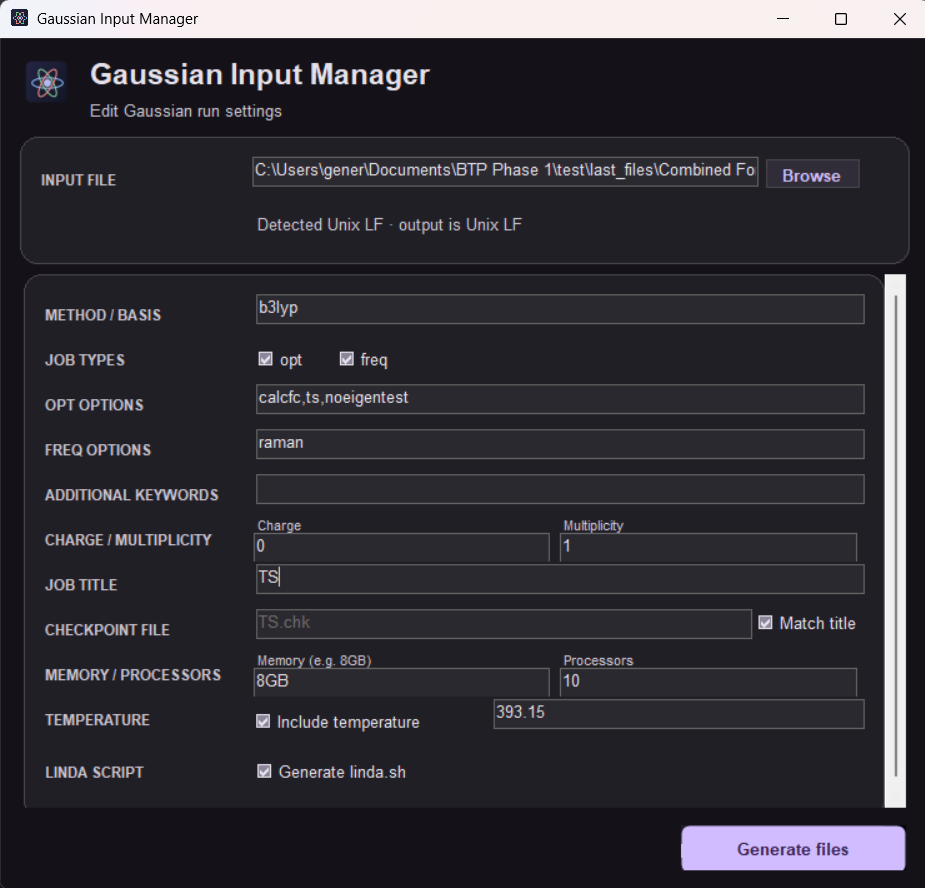

# Gaussian Input Manager

A small Windows utility for changing the run settings in an existing Gaussian input file. It leaves the coordinate and connectivity data alone and writes a new `.com` file with Unix line endings.



## What it does

- Reads `.com` and `.gjf` files and fills in the editable settings from the input.
- Lets you select `opt`, `freq`, or both, and enter options for each.
- Places optional additional keywords between the method/basis and `geom=connectivity`.
- Keeps the geometry and connectivity block from the original input.
- Removes `%lindaworkers` from generated input and starts the file with `%mem`.
- Optionally creates `linda.sh` from the bundled template, updating the job name, memory, and processor count.
- Uses Google Sans and the project logo in the app.

## Run it

Download the latest Windows executable from the [Releases page](https://github.com/eevx/Gaussian-Input-Manager/releases). It runs on Windows with the .NET Framework available.

## Build from source

The project uses the Windows Forms compiler that ships with the .NET Framework. From PowerShell, run:

```powershell
powershell -ExecutionPolicy Bypass -File .\build.ps1
```

The script writes the executable to `release/GaussianInputManager.exe`. It embeds the font, logo, icon, and Linda template, so those files do not need to sit beside the app when it runs.

## Project files

- `src/` — application source
- `assets/` — logo, Windows icon, and Google Sans font
- `resources/linda.sh.template` — starting point for generated Linda scripts
- `release/` — prebuilt executable

Google Sans comes from the [Google Fonts Google Sans repository](https://github.com/googlefonts/googlesans) and is distributed under the SIL Open Font License; its license is in `assets/fonts/OFL.txt`. The app source and project logo use the MIT license in `LICENSE`.

Developed to save my time, feel free to add changes if anyone wants.
